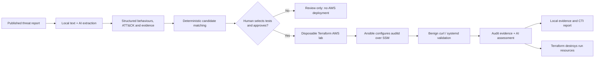

# SEC598 Coin Challenge: Threat-Informed Validation

## SANS SEC598 Coin Challenge Submission

**[View the final submission report](report/SEC598-report.html)**

This repository is a sanitised snapshot of my SEC598 project.

The HTML report is the main submission deliverable. Download it
and open it in a browser for the formatted report.

Supporting material includes:
- Python AI analysis and validation orchestration
- Terraform and Ansible infrastructure configuration
- Architecture and implementation documentation
- Sanitised evidence from the curl and systemd tests

**Security note:** Real AWS identifiers, credentials and operational
logs have been excluded. Cloud configuration contains placeholders
and is not ready for deployment without modification.

---


**A human-approved, AI-assisted workflow for turning published adversary behaviour into safe, repeatable Linux telemetry validation in disposable AWS infrastructure.**

> **Status:** Working proof of concept, demonstrated locally on 7 November 2026. This is a learning/validation lab, **not** a production detection platform or an implementation of the reported exploit.

## What problem does it solve?

A threat report may describe dozens of adversary behaviours. The operational question is not simply "What ATT&CK techniques are mentioned?", but **"Which behaviours matter, can we reproduce a safe analogue, and does our telemetry capture it?"**

This project combines structured CTI analysis with a small, explicitly approved test catalogue. It builds an isolated AWS lab, runs benign behaviours, retrieves Linux audit evidence, assesses what the evidence actually proves, and destroys the temporary infrastructure. It keeps **behaviour observed**, **execution confirmed**, **telemetry confirmed** and **detection confirmed** separate.

The worked example is Microsoft's 30 September 2026 [CVE-2026-73570 Zimbra exploitation report](https://www.microsoft.com/en-us/security/blog/2026/09/30/unauthenticated-command-injection-on-internet-facing-mail-servers-tracking-cve-2026-73570/). The report includes multiple compromises: **do not assume all reported behaviours occurred on one host**.

## Architecture

See [Architecture and data flow](docs/architecture.md) for the full diagrams, trust boundaries, state isolation and evidence lineage.



**The source-report extraction is a preparation step.** The approved CTI run consumes an **existing** analysis JSON file; it does not automatically reanalyse a new report every time.

## Supported safe analogues

| CTI signal | Validation scenario | What it tests | What it does **not** test |
| --- | --- | --- | --- |
| T1105 / shell-assisted retrieval | `curl` | Benign `curl` download from `https://example.com`, execution and audit visibility | Zimbra exploitation, payload execution, pipe-to-shell, malicious C2 |
| T1543.002 / systemd service | `systemd` | Creation and start of a harmless one-shot systemd unit, file creation and execution telemetry | Reboot persistence, timestomping, actor intent, a detection rule |

Both are **analogues**, not exploit emulation. Only prewritten commands in `app/run_validation.py` can execute.

## Repository layout

| Path | Role |
| --- | --- |
| `app/parse_report.py` | Extracts text from a locally saved copy of the Microsoft HTML article |
| `app/analyse_report.py` and `app/schemas/threat_analysis.py` | Hosted OpenAI structured threat-behaviour extraction |
| `app/render_analysis.py` | Optional HTML view of extracted behaviours |
| `app/run_cti_validation.py` | Terminal dashboard; `--plain` shows original console output |
| `app/cti_engine.py` | CTI candidate matching, source-quote checks, approval gate and consolidated report |
| `app/run_pipeline.py` | Terraform, SSM readiness, Ansible, validation orchestration, teardown |
| `app/run_validation.py` | The two approved SSM emulations and per-test evidence collection |
| `app/parse_audit.py` / `app/assess_validation.py` | Deterministic audit parsing and structured AI evidence assessment |
| `config/ansible/telemetry.yaml` | Installs auditd, adds rules and removes the default suppression rule |
| `infra/bootstrap-state/` | Separate, **persistent** S3 Terraform-state bucket |
| `infra/terraform/` | Disposable target configuration and original-lab configuration |
| `docs/` | Architecture, operations/recovery, CTI baseline and coin write-up |
| `data/reports/`, `data/runs/` | Local inputs and outputs; intentionally **not committed** |

## Prerequisites

The implementation has been used on an **Ubuntu VM**. It requires:

- Python and the pinned dependencies in `requirements.txt` (the development VM used Python 3.14).
- AWS CLI v2, valid credentials (`aws login` is used for local development), and access to the **configured** AWS account in `eu-north-1`.
- Terraform >= 1.16 with the AWS provider defined in the lock file; a reachable persistent S3 state bucket.
- Ansible with the `amazon.aws` collection and the AWS Session Manager plugin installed on the control machine.
- Permissions to manage the lab's EC2, VPC, IAM, S3 and SSM resources.
- An OpenAI API key for **analysis and assessment**. The model identifier in the current source is `gpt-6-luna`; availability and access must be verified in your environment.
- The source report downloaded locally. **Neither its full text nor the generated AI analysis is in Git.**

**Portability warning:** `app/run_pipeline.py` hard-codes the expected AWS account/region; `infra/terraform/backend.tf` names an existing S3 bucket. These are deliberate constraints in the current lab, **not** automatic multi-account deployment support. Review them before running in a different account. This public copy uses placeholder AWS identifiers and is not configured for live deployment.

## Setup on the existing Ubuntu lab

From the repository root:

```bash
python3 -m venv .venv
source .venv/bin/activate
python -m pip install -r requirements.txt
ansible-galaxy collection install amazon.aws

aws sts get-caller-identity
# If the local session has expired:
aws login

terraform version
ansible --version
```

The permanent S3 backend must already exist, and the backend configuration must point to it. **Never run `terraform apply` or `terraform destroy` in `infra/terraform/` to operate on a disposable run.** That directory's default backend points to the original, non-disposable lab state.

Create a local `.env` (ignored by Git) containing `OPENAI_API_KEY=...` for the hosted assessments. Do not commit credentials or state files.

## Prepare the Zimbra example (one-time / whenever input changes)

Download the [official Microsoft report](https://www.microsoft.com/en-us/security/blog/2026/09/30/unauthenticated-command-injection-on-internet-facing-mail-servers-tracking-cve-2026-73570/) and save its HTML as `data/reports/zimbra-cve-2026-73570.html`. The current parser expects Microsoft's page structure and particular text markers; if those change, extraction may need inspection.

```bash
mkdir -p data/reports data/runs
python -m app.parse_report
python -m app.analyse_report
python -m app.render_analysis
```

This produces `data/reports/zimbra-cve-2026-73570.txt` and `data/runs/zimbra-cve-2026-73570-analysis.json`. The AI analysis is a structured interpretation of the supplied text and requires human review.

## Run modes

**1. Review the CTI candidates, with no AWS deployment or new model call:**

```bash
python -m app.run_cti_validation
```

**2. Inspect an isolated Terraform plan only (authenticated AWS access required; no lab resources created):**

```bash
python -m app.run_pipeline --scenario curl
```

**3. Approve and run the complete CTI-to-validation flow (creates real AWS resources):**

```bash
python -m app.run_cti_validation --select curl --select systemd --approve
```

The last command reuses **one** disposable environment for both scenarios. A terminal dashboard shows stages and an indeterminate activity bar; a 30-second `[y/N]` prompt offers to open the report in `less`. For full troubleshooting output, add `--plain`.

A standalone infrastructure-driven run (without CTI matching) is also supported:

```bash
python -m app.run_pipeline --scenario curl --approve
```

**Costs and safety:** `--approve` authorises provisioning and execution. Teardown is attempted even if a stage fails, but **is not guaranteed** after VM crashes, hard kills, expired credentials or AWS errors. Always check the run manifest and Terraform state before leaving a failed run.

## Results and interpretation

Successful runs produce local files under `data/runs/`, including a `cti-report.md`, `cti-manifest.json`, source snapshots, per-test audit/assessment evidence and a `pipeline-manifest.json` with teardown status. Generated files are excluded from Git; the repository alone does not contain the proof-of-execution artefacts.

The locally reported demonstration on 7 November 2026 completed **curl** and **systemd** with:

| Question | Reported outcome |
| --- | --- |
| Behaviour observed? | Yes |
| Execution confirmed? | Yes |
| Relevant telemetry confirmed? | Yes |
| Detection confirmed? | **No**: no detection engine or rule was tested |
| Disposable infrastructure torn down? | Reported succeeded |

These are results from the user's local run reports, **not continuously verified GitHub CI results**. The original audit evidence remains in the local run directories.

## Limits and security boundaries

- **No Zimbra installation, vulnerable server, malware, C2, privilege escalation or persistence-across-reboot testing.**
- ATT&CK mappings are analytical candidates; the match is not proof that a safe analogue reproduces adversary behaviour.
- Exact quote checking uses normalised substring matching, not independent semantic verification of the entire report.
- AI assessments are constrained by Pydantic schemas and prompts, but should still be inspected against the captured evidence.
- Telemetry visibility must never be advertised as detection or MDR readiness.
- The dashboard infers stage changes from console text, not a structured event stream.
- No unattended remote GitHub Actions/OIDC runner or automated regression CI is implemented yet.

For deeper details: [Architecture](docs/architecture.md) · [Coin submission draft](docs/coin-submission.md).

## Origin

Built for the SANS SEC598 coin challenge as a practical exercise in structured AI extraction, security automation and evidence-driven validation. The implementation and selected analogues are intentionally limited to what can be tested safely and reproducibly in this learning lab.


## Public submission notice

This is a sanitised review copy. AWS identifiers and the live state backend have been replaced with placeholders. Do not run approved infrastructure operations without configuring your own isolated AWS environment. The evidence excerpts retain selected original fields, but raw logs and sensitive operational metadata are omitted.
