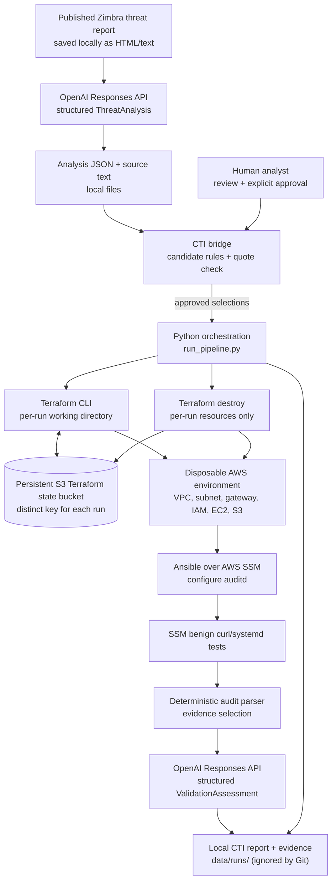
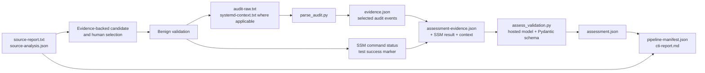

# Architecture: CTI to disposable AWS validation

This document describes the **implemented** design in this sanitised submission repository. It is an intentionally small local learning lab, not a continuously running threat intelligence platform.

## System context



The raw HTML/text report is acquired **manually**. `app/parse_report.py` can turn the saved Microsoft page into text. `app/analyse_report.py` then performs one structured analysis with the hosted model, and `app/run_cti_validation.py` consumes the resulting local analysis JSON. A normal approved validation run does **not** fetch or reanalyse the original report automatically.

## Components and responsibilities

| Component | Runs where | Responsibility |
| --- | --- | --- |
| `parse_report.py` | Ubuntu controller | Select the report article body from saved HTML and emit plain text |
| `analyse_report.py` | Ubuntu + hosted OpenAI API | Extract behaviours, ATT&CK candidates, confidence, quotes and uncertainties using a Pydantic schema |
| `cti_engine.py` | Ubuntu controller | Map CTI to a two-scenario allowlist, check normalised quotes against report text, enforce `--select`/`--approve`, preserve CTI inputs and produce final report |
| `run_cti_validation.py` | Ubuntu terminal | Progress dashboard and optional report-opening prompt; `--plain` gives full engine output |
| `run_pipeline.py` | Ubuntu controller | Verify expected AWS account, prepare separate Terraform backend, check creation-only plan, provision, configure, validate, attempt destroy, record recovery information |
| Terraform | Ubuntu + AWS API | Provision target VPC, subnet, route, internet gateway, security group, EC2 instance, SSM IAM role/profile and disposable Ansible-transfer S3 bucket |
| Ansible `amazon.aws.aws_ssm` | Ubuntu ↔ SSM/S3 ↔ EC2 | Install/configure auditd without opening an inbound SSH port |
| `run_validation.py` | Ubuntu + SSM on EC2 | Execute one selected benign test, collect telemetry and systemd context, call parser and assessment, clean up test files/unit |
| `parse_audit.py` | Ubuntu controller | Select relevant `EXECVE` and systemd-unit-creation audit records |
| `assess_validation.py` | Ubuntu + hosted OpenAI API | Produce structured findings and four explicitly separate verdict booleans |
| `cti-report.md` and evidence directory | Ubuntu local disk | Preserve source-to-test traceability, assessment, cleanup result and detailed artefacts |

The controller's AWS-facing actions use AWS CLI and Terraform. There is no live EDR or detection pipeline in the architecture.

## Run sequence

```mermaid
sequenceDiagram
    actor H as Analyst
    participant C as CTI CLI / engine
    participant P as Pipeline controller
    participant T as Terraform
    participant A as AWS / SSM / EC2
    participant V as Validation runner
    participant M as OpenAI assessment
    H->>C: Review extracted candidates
    C-->>H: Supported analogues + report evidence
    H->>C: --select curl --select systemd --approve
    C->>P: Launch approved scenarios
    P->>A: STS caller identity check
    P->>T: init unique S3 state key; plan
    T-->>P: Create-only resource plan
    P->>P: Reject changes, replacements or destroys
    P->>T: Apply saved plan
    T->>A: Provision disposable resources
    A-->>P: EC2 ID + transfer bucket
    P->>A: Wait for SSM Online
    P->>A: Ansible over SSM; configure auditd
    loop For each selected scenario
        P->>V: Run test against explicit EC2 ID
        V->>A: Execute benign SSM command
        V->>A: Retrieve bounded audit and system context
        A-->>V: Execution status and audit evidence
        V->>M: Evidence-based structured assessment
        M-->>V: Four verdicts + findings
        V->>A: Remove test artefacts
        V-->>P: Local validation manifest
    end
    P->>T: Attempt destroy in finally block
    T->>A: Destroy only run-owned resources
    T-->>P: Remaining state check
    P-->>C: Pipeline manifest + report
    C-->>H: CTI report + preserved evidence
```

Important failure nuance: Terraform teardown is attempted on normal success/failure and handled interrupts. A hard process kill, host crash, expired AWS session or provider failure can leave resources behind. The independent state and recovery command are intentionally retained.

## State, ownership and isolation

There are **three different concepts** that must not be conflated:

1. **Bootstrap state bucket:** `infra/bootstrap-state/` creates the long-lived encrypted/private S3 bucket (versioning enabled; `prevent_destroy`). This is infrastructure for storing Terraform state, **not** a disposable validation target.
2. **Original lab state:** `infra/terraform/backend.tf` defaults to `coin/terraform.tfstate`. That is the pre-existing development environment and is never an acceptable target for an automated disposable teardown.
3. **Per-run state:** `run_pipeline.py` copies the Terraform files into `data/runs/<pipeline-id>/terraform/` and initialises the same S3 backend with `runs/<pipeline-id>/terraform.tfstate`. It checks the backend key and only accepts an initial plan with **create** actions for known resources.

Unique `deployment_suffix` values avoid fixed-name collisions for the IAM role/profile and security group. The pipeline uses Terraform's `target_instance_id` output instead of searching by a shared project tag. The temporary transfer bucket uses `force_destroy = var.deployment_suffix != ""`; this does **not** apply to the persistent state bucket or the no-suffix development lab.

The AWS target is an Amazon Linux 2023 `t3.micro` in a dedicated VPC/subnet with outbound connectivity and **no security-group ingress rules**. SSM manages access without incoming SSH. The instance receives `AmazonSSMManagedInstanceCore` through its role; the controller's AWS identity and permissions are separate.

## Evidence flow



### Verdict meanings

| Field | Meaning |
| --- | --- |
| `behaviour_observed` | Supplied evidence supports the expected test behaviour |
| `execution_confirmed` | Command/result evidence supports execution |
| `telemetry_confirmed` | Relevant host audit evidence was captured |
| `detection_confirmed` | **Only** true when an actual detection analytic or rule firing is evidenced |

There is **no detection engine in the current lab**. A result of `detection_confirmed = false` is expected and does not mean a detection was tested and failed. Similarly, a successful harmless curl does not establish that a malicious pipeline would be detected.

### Local run artefacts

```text
data/runs/
  zimbra-cve-2026-73570-analysis.json    # Pre-generated CTI extraction
  cti-<id>/
    source-report.txt
    source-analysis.json
    cti-manifest.json
    cti-report.md
    pipeline-console.log
    evidence/
      pipeline-manifest.json
      pipeline-report.md
      logs/
      validations/
        curl/
        systemd/
  <pipeline-id>/
    pipeline-manifest.json
    pipeline-report.md
    inventory.yml
    logs/
    terraform/                          # Contains backend cache/state metadata
  <validation-id>/
    manifest.json
    audit-raw.txt
    audit-parsed.json
    evidence.json
    assessment-evidence.json
    assessment.json
    execution.json
    cleanup.json
```

The exact file set depends on the scenario and whether a stage succeeds. The CTI evidence bundle **copies** relevant child evidence, while standalone pipeline and validation runs retain their original directories. These local data files are ignored by Git.

## Trust boundaries and deliberate choices

- **Threat report is untrusted input.** The model extracts candidate behaviours, but cannot directly choose arbitrary shell commands.
- **Human approval is the execution boundary.** The deterministic catalogue only permits `curl` and `systemd`. `--approve` is needed for provisioning and validation.
- **The model assesses, not executes.** The hosted assessment gets bounded, locally selected evidence; Terraform, Ansible and SSM execute predefined operations.
- **Exact quote checks are deliberately limited.** Normalised substring comparison can reject paraphrases; it is not a full provenance or correctness proof.
- **Account/region pinning is intentional.** This lab's controller rejects unexpected AWS accounts. It is not portable without review.
- **No claim of production containment or detection readiness.** This is a telemetry-level proof of concept; attack-chain, detection-rule, response and cost/performance validation are outside scope.

## Known implementation limitations

1. The dashboard interprets emitted log strings to update stages. It is not driven by first-class structured lifecycle events, and the bars are activity indicators rather than timed percentages.
2. Automated tests and GitHub Actions are not part of the current repository; successful local runs are reported separately.
3. `run_pipeline.py` attempts cleanup in `finally`, but cannot guarantee cleanup after a crash or lost credentials. Inspect per-run state and use the documented recovery procedure.
4. Ansible audit collection is Linux-specific and the test catalogue has only two entries.
5. Analysis input is a local snapshot, not automatically refreshed OSINT; source parsing is tailored to one article.
6. The initial Terraform source directory still contains the original lab backend. Do not perform unsupervised `apply` or `destroy` from that directory.

See [Coin submission write-up](coin-submission.md) for project scope, results and limitations.
